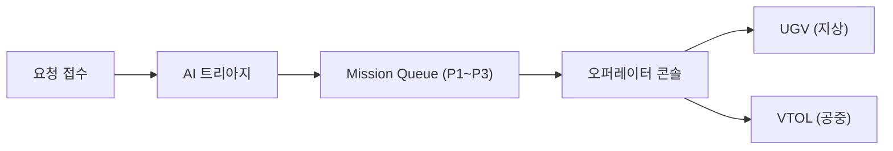

# SUPPORTY

> 오퍼레이터 한 명이 AI 코파일럿과 함께 지상(UGV)과 공중(VTOL) 무인자산을 지휘하는 작전지속지원 통제 시스템. D4D APAC 서울 해커톤 팀 출품작의 공개 사이트 저장소입니다.

*English: SUPPORTY is a contested-logistics control system where one operator commands ground (UGV) and aerial (VTOL) unmanned assets with an AI copilot, built in 24 hours at the D4D (Deploy for Defense) APAC Seoul hackathon. This repository is the team's public site.*

- 데모 사이트: https://supporty-d4d.github.io/
- 영어 페이지: https://supporty-d4d.github.io/en/
- 기획서(PDF): https://supporty-d4d.github.io/assets/supporty_proposal.pdf
- 포트폴리오 상세: https://jang961111-hash.github.io/projects/supporty/


*SKYFLEET C2 오퍼레이터 콘솔(SKYFLEET는 콘솔 화면의 이름): 듀얼 카메라, 전술 지도, AI 트리아지 Mission Queue, 음성 AI 패널*

## 30초 요약

- **문제**: 무인체계 운용은 자산 1대당 조종사 1명이 붙는 선형 인력 구조라, 장비가 늘수록 인력도 같이 늘어야 합니다.
- **해결**: 전투가 아니라 작전지속지원(보급, 정찰, 중계)을 서비스 범위로 잡았습니다. 작전 판단은 군이 하고, 서비스는 요청 접수, 우선순위 분류, 자산 배분, 실행만 맡습니다. 오퍼레이터 한 명이 AI 코파일럿과 함께 여러 자산을 지휘하는 콘솔로 설계했습니다.
- **설계한 기능** (실행 코드는 이 저장소에 없고, 이 저장소는 소개 사이트와 화면 시안입니다)
  - 자연어 지휘: 문장을 제어 시퀀스로 변환
  - AI 트리아지: 생명 직결도, 시간 민감도, 임무 파급효과 순으로 요청 정렬
  - 듀얼 카메라 병렬 제어, GPS 재밍 대비 비전 항법 전환, 셀룰러와 위성 링크 핫스탠바이
- **결과**: 24시간 개발 안에 실물 UGV와 VTOL을 연동한 라이브 콘솔로 시연했고, Oregon UAS Accelerator 특별 트랙에 **선정**되었습니다(수상이 아닌 선정).

| 항목 | 내용 |
| --- | --- |
| 행사 | D4D Hackathon APAC Seoul 2026 |
| 기간 | 2026.07.03 - 2026.07.05(24시간 개발) |
| 팀 | SUPPORTY 2인 팀(하드웨어, 운용 리드 / 기획, 소프트웨어) |

## 기여

장병헌: 기획, 프론트엔드. 오퍼레이터 콘솔 기획, 데모 시나리오 설계, 콘솔과 랜딩 페이지 프론트엔드 구현을 맡았습니다. 하드웨어와 운용은 팀의 다른 구성원이 담당했습니다.

## 구조



한 화면에 듀얼 카메라, 전술 지도, Mission Queue, 자산 로스터, 음성 AI 패널을 둡니다. 이륙, 순항, 대기 같은 저위험 구간은 AI가 맡고, 험로, 관측, 회피처럼 사람이 필요한 순간에만 제어권을 넘기는 구조입니다.

| 지상 자산(UGV) | 공중 자산(VTOL) |
| --- | --- |
|  |  |
| 전면 카메라와 통신 모듈을 단 보급 차량 | Heewing T2 VTOL(ArduPlane) |

## 이 저장소로 보는 방법

이 저장소는 빌드 도구 없는 정적 사이트(HTML, CSS, JS)이고, `main` 브랜치에 푸시하면 GitHub Actions(`.github/workflows/pages.yml`)가 저장소 루트를 GitHub Pages로 배포합니다.

| 파일 | 내용 |
| --- | --- |
| `index.html` | 한국어 랜딩 페이지 |
| `en/index.html` | 영어 랜딩 페이지 |
| `demo.html` | 오퍼레이터 콘솔 화면을 정적으로 재현한 시안(스크립트 없음, 동작하지 않음, 오프라인용) |
| `console.html` | 실서버 콘솔 링크와 실제 운용 화면 캡처 |
| `assets/` | 이미지, 시나리오 영상(mp4), 기획서 PDF |

로컬에서 열기:

```bash
git clone https://github.com/supporty-d4d/supporty-d4d.github.io.git
cd supporty-d4d.github.io
python3 -m http.server 8000
# 브라우저에서 http://localhost:8000/ (demo.html, console.html, en/ 도 같은 주소 아래)
```

`index.html`을 파일로 바로 열어도 되지만, 영어 페이지 링크(`/en/`)가 루트 기준이라 서버로 여는 편이 안전합니다. 폰트는 Google Fonts를 불러오므로 오프라인에서는 기본 폰트로 보입니다.

## 한계와 참고

- `console.html`의 실서버 콘솔은 시연 기간에만 운영한 것으로, 현재는 접속되지 않을 수 있습니다. 그때는 같은 페이지의 운용 화면 캡처나 화면 시안인 `demo.html`을 보세요.
- 시나리오 영상 `assets/op_*.mp4` 3개는 이미 저장소에 올라가 있지만, `.gitignore`가 `*.mp4`를 제외하므로 새 mp4를 추가하려면 `git add -f`가 필요합니다.
- `DEPLOY_GUIDE.md`는 해커톤 당시 작성한 배포 안내로, 안의 경로와 저장소 이름은 현재와 다릅니다.
